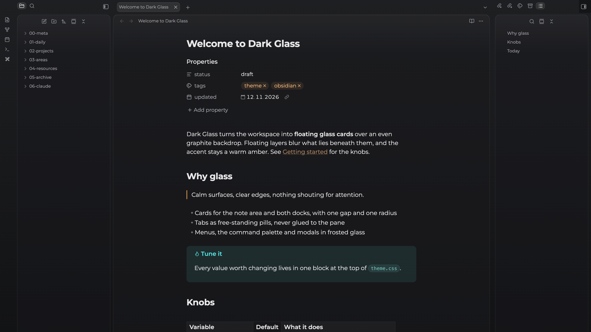
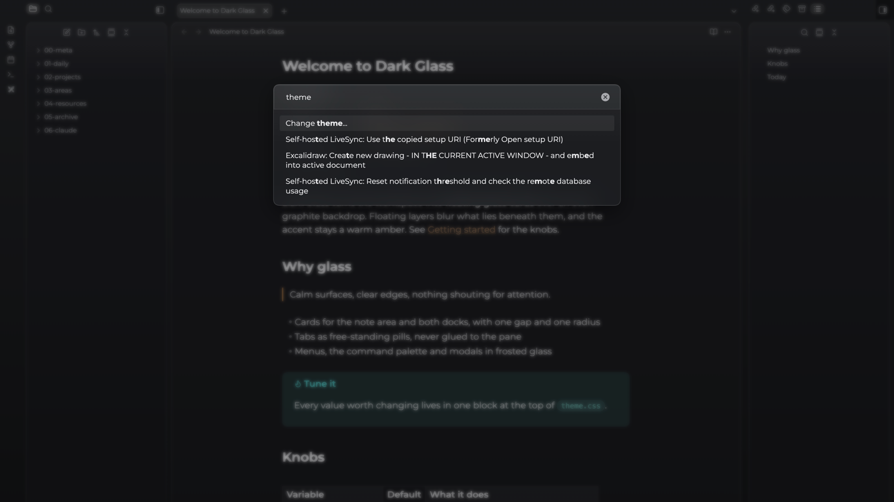
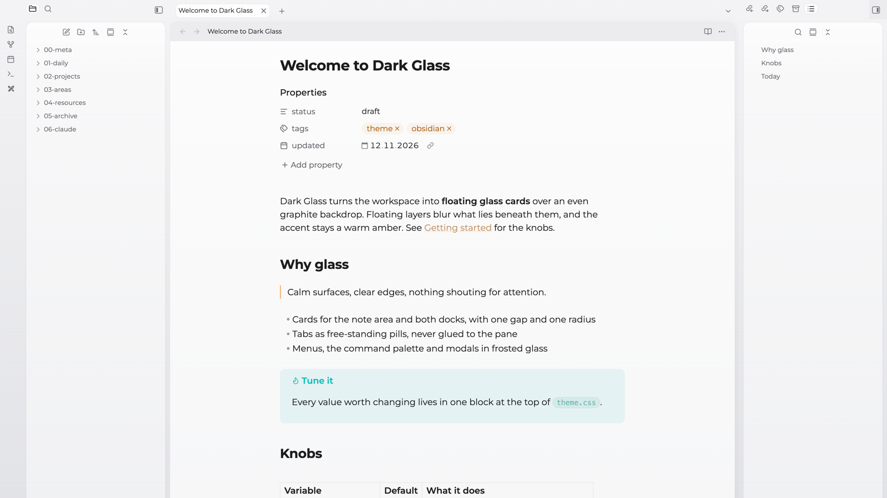
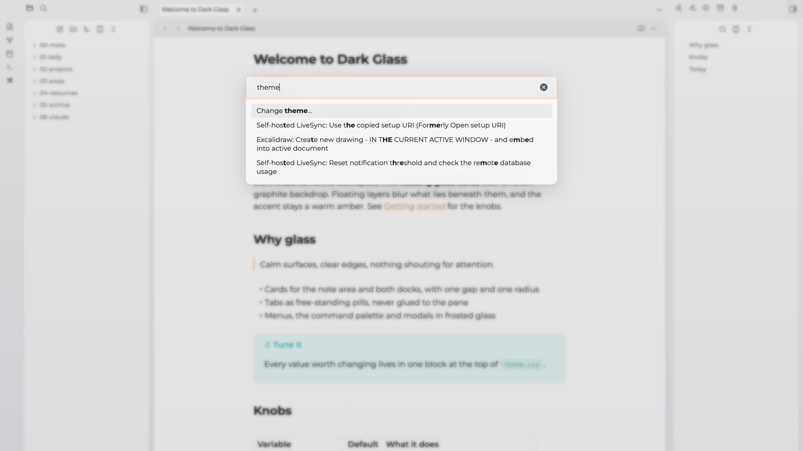

# Dark Glass

A calm glass theme for [Obsidian](https://obsidian.md), dark and light: the workspace becomes floating glass cards over an even, colourless backdrop, with one warm amber accent.



## What it does

- **Glass cards.** The note area and both side docks are rounded, translucent cards with a thin light edge, one gap and one radius everywhere.
- **Even backdrop.** Graphite in dark mode, pale paper grey in light mode: one colourless gradient behind everything, no coloured glows.
- **Pill tabs.** Tabs are free-standing pills with a gap above the note, never glued to the pane. Stacked tabs stay readable.
- **Frosted layers.** Menus, the command palette, modals, suggestions, hover previews and notices blur what lies beneath them (desktop only).
- **Settings window.** Obsidian 1.15 opens Settings in its own window; it gets the same backdrop, glass navigation and setting cards.
- **Quiet inline fields.** Properties, rename fields and the inline title have no boxes until you hover or focus them.
- **Montserrat** for text and interface, embedded in the theme, and the system monospace font for code.
- **Plugin touches.** The Strange New Worlds reference count becomes a small glass pill. Self-hosted LiveSync's status-bar item sits in the status-bar pill; its optional in-editor status is left as the plugin draws it.



## Modes

Both. Dark mode is smoked glass over graphite; light mode is white glass over pale grey, with softer shadows and a darker amber for links so they read on white. Obsidian switches between them with **Settings → Appearance → Base color scheme**.





On mobile the same palette is drawn with flat fills and no cards or blur, so a phone does not pay for backdrop filters.

## Install

From Obsidian: **Settings → Appearance → Themes → Manage**, search for **Dark Glass**, then **Install and use**.

By hand: download `manifest.json` and `theme.css` from the [latest release](https://github.com/oleksiimazurenko/obsidian-dark-glass/releases/latest) into `<your vault>/.obsidian/themes/Dark Glass/`, then pick **Dark Glass** in **Settings → Appearance → Themes**.

## Tune it

Every value worth changing is in the first block of `theme.css`. To override one without editing the theme, put it in a [CSS snippet](https://help.obsidian.md/snippets):

```css
body {
  --accent-h: 32;            /* accent hue (HSL); 210 for blue, 270 for violet */
  --accent-s: 85%;
  --accent-l: 64%;
  --glass-see-through: 0.62; /* 0 = solid cards, 1 = clear */
  --glass-graphite-top: 30 31 34;    /* dark backdrop gradient, rgb */
  --glass-graphite-bottom: 17 18 20;
  --glass-paper-top: 243 243 245;    /* light backdrop gradient, rgb */
  --glass-paper-bottom: 224 225 229;
  --glass-blur: 24px;        /* blur under floating layers */
  --glass-gap: 8px;          /* gap between cards */
  --glass-radius: 14px;      /* card corners */
}
```

## Licence

The theme is released under the [MIT License](LICENSE).

It embeds the [Montserrat](https://github.com/JulietaUla/Montserrat) typeface (Regular, Medium, SemiBold, Bold), © The Montserrat Project Authors, licensed under the [SIL Open Font License 1.1](OFL.txt).
